# FORMA — System flows (systems-analysis view)

> **สรุปภาษาไทย** — เอกสารนี้เขียนแบบ SA: context diagram, use case, ลำดับการทำงานทีละขั้น (process flow),
> sequence diagram ของแต่ละเส้นทาง และ state machine ของ round / mapping / dataset / batch item / job / คำถาม
> รวมถึงการปิดรอบ (ยกเลิก ย้าย แทนไฟล์) คำถามที่รอลูกค้าตอบ ผู้ช่วย (รันโค้ด ไฟล์ในแชต ผลงาน ความจำ)
> และงานดูแลระบบ (ล้างข้อมูลเก่า สำรองข้อมูล) ทั้งหมดเขียนตามการใช้งานจริง คือคนเดียวบนเครื่องเดียว
> ทุกแผนภาพเป็น Mermaid (GitHub แสดงผลได้) แต่ละขั้นอ้าง ADR ที่เป็นเหตุผลของการออกแบบ

Diagrams are Mermaid; GitHub renders them. Each step names the module that implements it and the decision
record that explains why. FORMA has one user on one machine, so the diagrams say *person* where the code has four
roles (§2).

## 1. Context

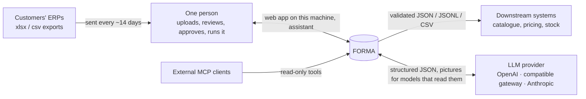

Everything runs in Docker on one machine: web, API, worker, PostgreSQL, Redis, MinIO, the code sandbox and the
nightly backup ([SYSTEM_ARCHITECTURE.md §7](SYSTEM_ARCHITECTURE.md#7-deployment)). Only that machine can open it
(R31). Two things in the code are not in this picture because this setup does not use them: an identity provider
(OIDC, ADR-013) and a trace collector (ADR-014). Both switch on by environment setting when FORMA moves to a server.

## 2. Use cases

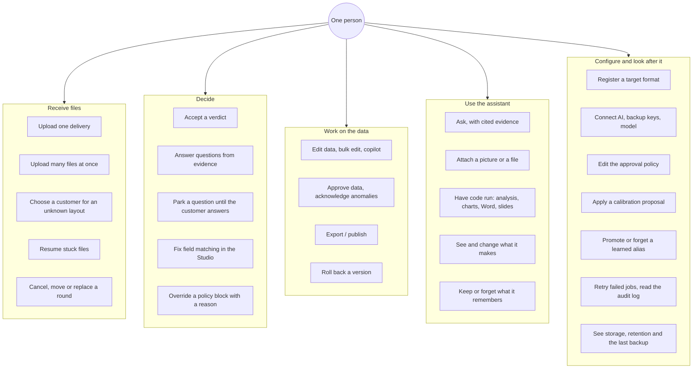

The code keeps four roles that nest, importer ⊂ reviewer ⊂ approver ⊂ admin, and this person holds all of them.
[USER_STORIES.md](USER_STORIES.md#เมื่อมีคนใช้เพิ่ม) says what they are for when someone joins.

## 3. Master process flow: one delivery, upload to export

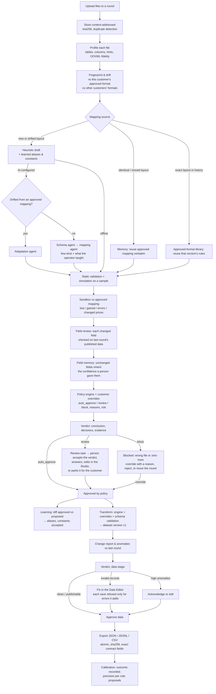

At any status a round can leave this path: cancelled, moved to another customer, or replaced by a corrected file
(§4.2).

### Step-by-step with the technique and the reason

| # | Step | Module | Technique | Why this technique |
|---|---|---|---|---|
| 1 | Store the file | `ingestion/store.py` | content-addressed sha256, immutable object, storage key on the row | Re-uploads are detected, nothing is ever overwritten, every later version can point at exactly these bytes (ADR-005, ADR-012) |
| 2 | Sniff and read | `ingestion/sniff.py`, readers, `ooxml.py` | content sniffing, strict CSV decoding with BOMs, full-sheet OOXML streaming with bounded XML | Extensions lie, CSV encodings vary (TIS-620), and silent data loss (uncached formulas, error cells, zero padding) must surface as facts, not vanish (ADR-003, ADR-043) |
| 3 | Detect tables and profile columns | `profiling/` | blank-row block detection over the whole sheet, bounded header window, a header printed again on each page dropped, type inference, hints, date order | ERP exports have titles, offsets and several tables per sheet; profiling must be descriptive so the mapper and the AI reason over facts, not raw cells |
| 4 | Fingerprint and classify drift | `fingerprint/` | strict + loose structural hashes, similarity, drift kinds; compare with the customer's approved format and with other customers' formats | Memory needs an exact key; drift needs a vocabulary a policy can reason about; a file identical to another customer's format is the strongest wrong-file signal (ADR-006) |
| 5 | Pick the mapping source | `services/mapping.py`, `format_memory.py` | memory (identical) → approved library (exact layout anywhere in history, newest first; closest compatible as adaptation baseline) → heuristic → AI | Reuse what a person approved before anything is guessed; a customer that alternates between two ERP layouts should not be re-asked (ADR-046) |
| 6 | Heuristic draft | `ai/heuristics.py` | synonym scoring (exact, containment, fuzzy), hint boosts, type compatibility, uniqueness for keys, value overlap, VAT guess from headers; learned aliases win outright; learned constants replace guesses | Deterministic, free, explainable, 0.996 on the corpus; it is the floor and the fallback, so the system never depends on a model being up (ADR-002, ADR-038) |
| 7 | AI refinement | `ai/agents.py`, `ai/llm.py`, `ai/guard.py` | structured JSON output against a schema, validation callback (DSL + static validation), retries, backup routes, output guard | The model adds judgement (nested promotions, ambiguous columns) but can only move inside the DSL; invalid or injected output is rejected and the draft is used; the full target schema is in the prompt so the model maps to the real contract (ADR-013, ADR-025, ADR-043) |
| 8 | Validate and simulate | `mapping_dsl/validate.py`, `simulate` | static validation; engine run on a bounded sample | Catch bad pointers and arity before data; give the policy rows, errors and warnings to reason about |
| 9 | Sandbox | `services/sandbox.py` | run the new and the approved mapping on the same real files; compare by schema identity | A new mapping must prove it does not lose records or break prices before it replaces the approved one; thresholds belong to the policy (ADR-018) |
| 10 | Field review | `services/healing.py` | per changed field, and per critical field of a reused mapping: equal share, steady ratio (×1.07 = VAT), scaled, different, on the same SKUs as last round's published data | A header that looks similar may mean something else, and a layout that did not move can still carry prices without VAT; the data says (ADR-021, ADR-056) |
| 11 | Field memory | `mapping.py::_inherit_confidence` | unchanged fields take confidence 1.0 from the approved mapping | A person already approved exactly this mapping of this field; asking again is noise (ADR-037) |
| 12 | Policy | `ai/policy.py` | thresholds per risk, allowed drift, warnings budget, first-time rule, row sanity, hard blocks, sandbox limits, meaning doubts, trust-data-checks, per-customer overrides | Automation is a configuration decision owned by the person running FORMA, with reasons, never a model's opinion (ADR-008, ADR-037) |
| 13 | Verdict | `services/verdict.py` | ordered hypothesis rules over the stored reports; suppression of same-rule-different-data, repeated patterns, no-data checks; confidence word; digest | A person reads one sentence and decides one to three things, with the evidence right under it (ADR-036, ADR-053) |
| 14 | Review | `review_questions.py`, `review_evidence.py`, `review_queue.py`, `ReviewWorkspace` | questions from fields under the confidence bar; answers become a new version with evidence; evidence traced to cells through engine provenance; preview on the same sample; a clock on every question, which can wait for the customer | Decisions are bounded and auditable; the person sees the actual cell, never a guess; an old question is visible and a parked one says whose turn it is (ADR-029, ADR-035, ADR-053) |
| 15 | Learning | `services/learning.py` | diff approved vs proposed (nearest system/ai ancestor) → aliases, constants, accepted; uses counted; suggestions ≥ 3 customers; a person promotes | A correction is made once per customer and once for everyone; the evidence on every learned field says where it came from (ADR-038) |
| 16 | Transform | `engine/transform.py`, `services/datasets.py` | DSL compiled to Polars expressions, vectorised records, persistent overrides re-applied, schema validation with invalid count, object-first write | Deterministic, fast, and nothing partial is visible (ADR-002, ADR-015, ADR-024, ADR-026) |
| 17 | Change intelligence | `datasets.py::change_report`, `anomalies.py` | diff vs the last published dataset; robust outliers (median/MAD); per-kind anomalies with severity; "% normal" | Reviewers need what changed and what looks wrong, not the whole table; high anomalies need an acknowledgement (ADR-022) |
| 18 | Edit | `datasets.py::apply_changes`, `assistant.py` | staged operations, impact preview, schema check that refuses only added errors, change set → new version; copilot plans, never applies | Fixes are reviewable and reversible; invalid records can be fixed one at a time (ADR-023, ADR-024, ADR-026) |
| 19 | Approve and export | `datasets.py::approve_dataset/export_dataset`, `publishing.py` | contract gate (no invalid records), anomaly acknowledgement, approver role for a manual export (a bulk round set to publish automatically exports on approval), atomic artifact with sha256, exact `export_view` fields | The downstream never receives a record that breaks the contract or a field it did not ask for (ADR-017, ADR-026) |
| 20 | Calibration | `services/calibration.py` | outcomes per decision from corrections, the version chain and change sets; precision per rule; proposals with evidence; a person applies | Thresholds are justified by what happened, and the next report shows whether a change was right (ADR-037) |

## 4. Bulk upload and automatic publishing

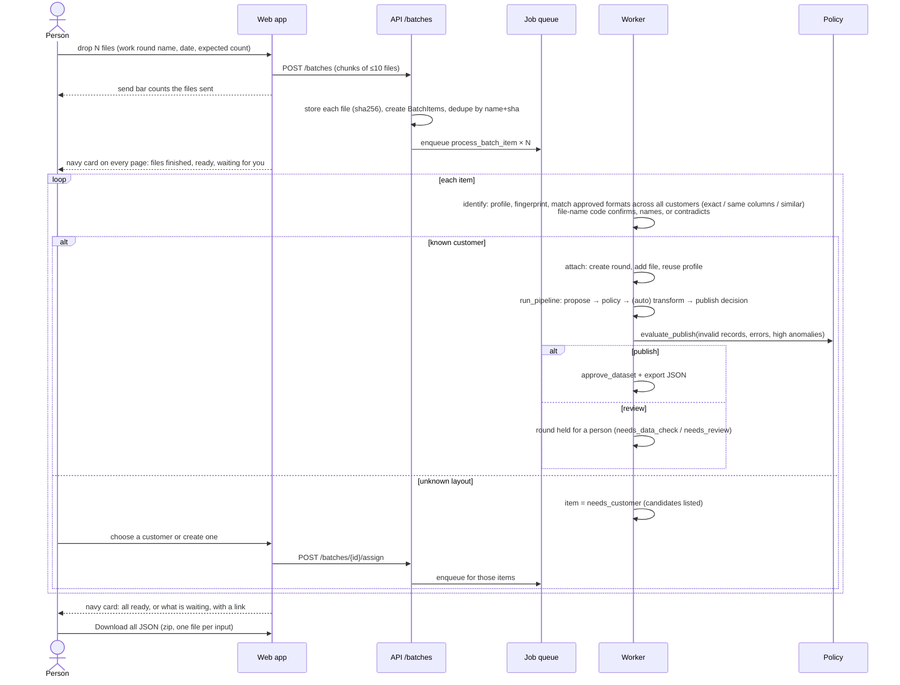

Stuck items (queue full or down at upload time) are detected and resumed (`POST /batches/{id}/resume`); on
startup, queued jobs whose results already exist are reconciled instead of re-run (ADR-027, ADR-044).

The navy card (`components/UploadCard.tsx`) reads `GET /batches/{id}/summary` every 3 seconds and follows the work
round across pages. On the round's own page it goes once the work is done, because that page has it all; elsewhere it
stays until read. When every remaining file is stuck it says the queue has stopped and nothing is lost, checks every
10 seconds, and cannot be closed.

### 4.1 A new round, or a corrected file

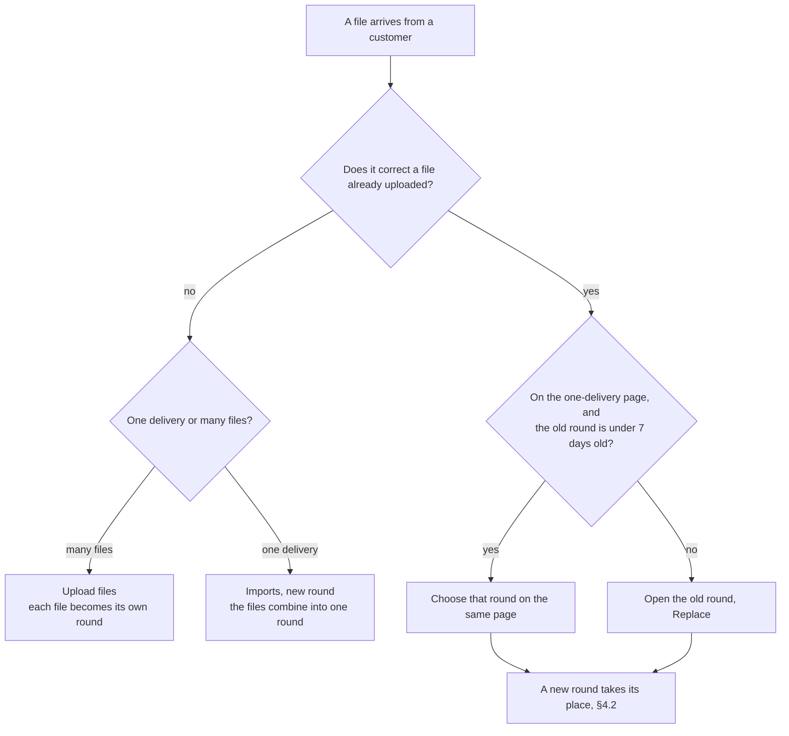

A customer's next delivery is always a new round. Earlier rounds stay as they are, and the approved format carries
over through mapping memory. Only a correction closes an older round. Bulk upload does not ask, because one upload
spans many customers (ADR-052). The same bytes under the same name in a work round are skipped; the same bytes
elsewhere are stored once and marked `duplicate_of`.

### 4.2 Closing a round: cancel, move, replace

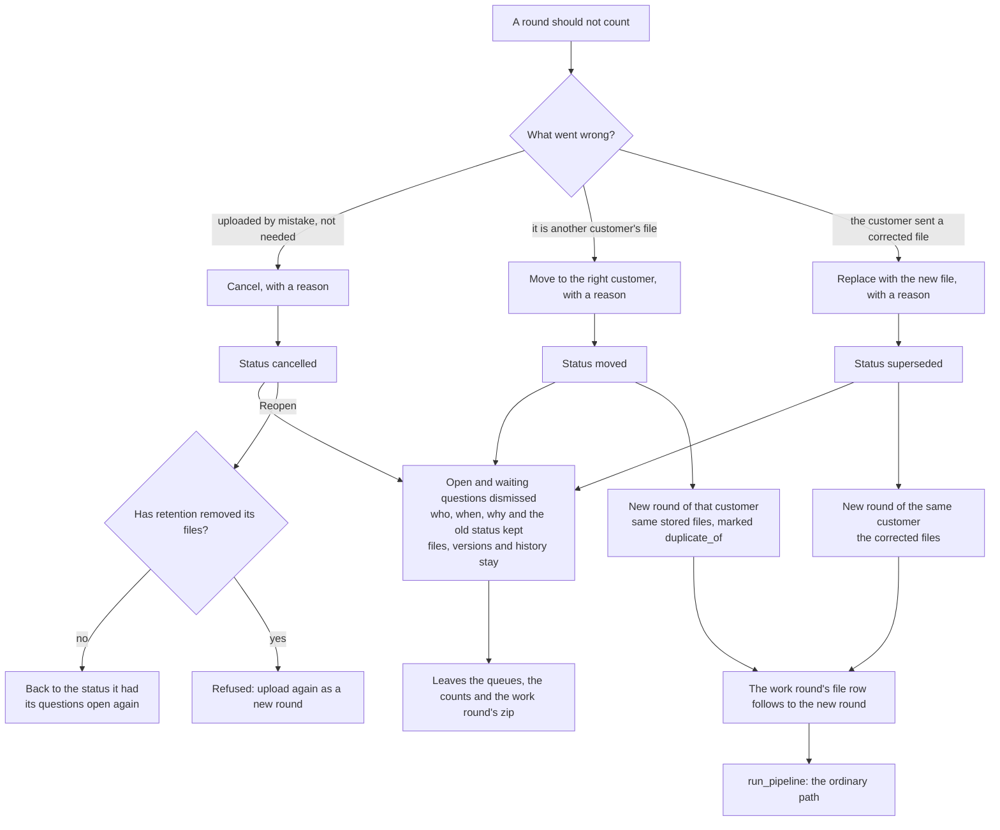

Nothing is deleted. Cancel can be undone; move and replace cannot, because a successor took the old round's place and
the two pages link to each other. A moved round runs the ordinary pipeline for its new customer, so a first-time
customer still gets a review. An approved mapping stays approved when its round is cancelled: approval is a fact about
the layout, not the delivery. Replacing a published round withdraws its JSON from the zip before the new one exists,
and the counts say so (`services/round_lifecycle.py`, ADR-052).

## 5. Review and verdict

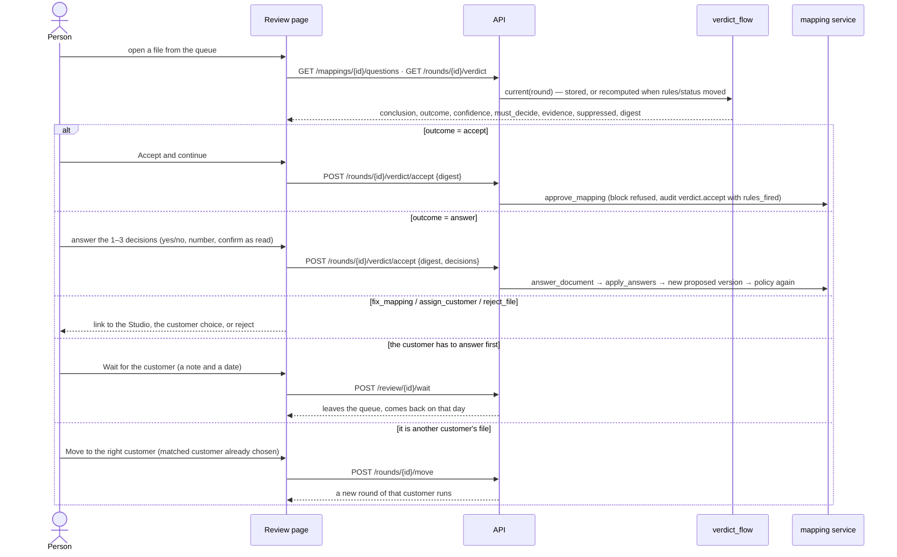

A stale digest (the file changed since the verdict was shown) is refused with 409 (ADR-036). Accepting while
decisions are listed is refused with 409 too, so the card has to be answered first (ADR-047). The states of a question
are in §8.6, and moving a round is in §4.2.

## 6. Learning and calibration loop

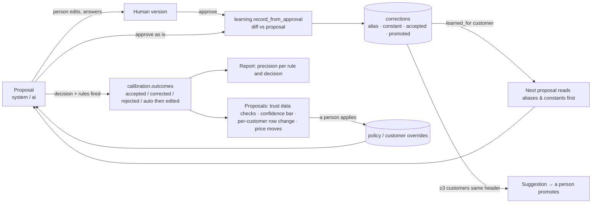

## 7. Assistant with grounded evidence and confirmable actions

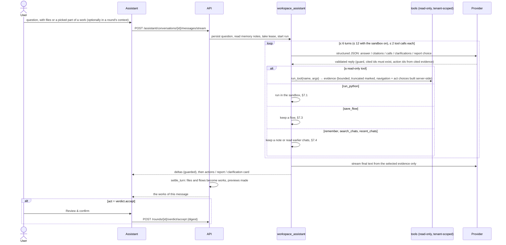

The model never supplies URLs, report values or action payloads; it selects server-built ids. Reports are computed
by the server under the user's permissions and persisted as snapshots (ADR-029, ADR-040, ADR-042, ADR-045). The code
it writes runs only in the sandbox, and the result stops at the chat (§7.1).

### 7.1 Running code in the sandbox

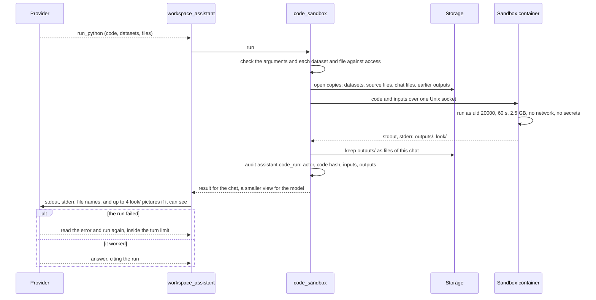

This is the one place AI output is executed, and it cannot reach a mapping, a dataset, the policy or an export. A run
works on copies, and the run directory is deleted afterwards. Limits for one run: 40 output files, 40 MB of output,
200 MB of input. `run_python` is not in `TOOLS`, so MCP clients never get it. The sandbox is on when
`FORMA_CODE_SANDBOX_SOCKET` is set, which the compose stack does; dev runs without it (ADR-048).

### 7.2 Files in a chat

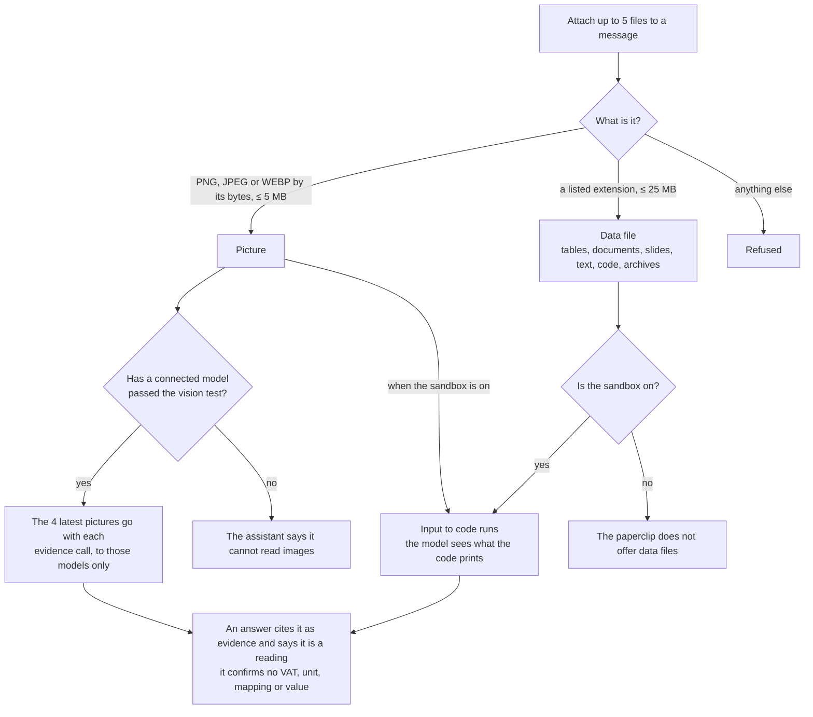

The writing phase works from its outline and receives no pictures. A file belongs to its chat: only that chat's owner
reaches it, it never becomes a record, a mapping or an export, and it leaves with the chat. Text in a picture or a file
is data, never an instruction (ADR-049).

### 7.3 Works and versions beside the chat

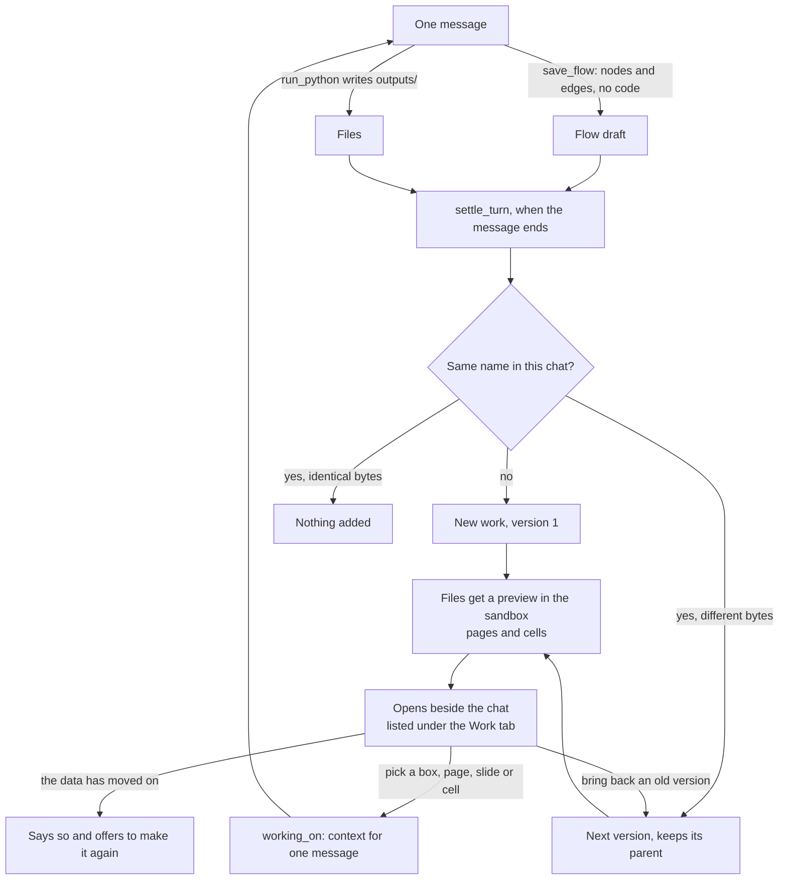

The last save of a name in a message wins, so nobody sees a draft the model threw away. A flow is data FORMA draws, so
it needs no sandbox. Files a model wrote are untrusted: only the sandbox opens them for a preview, and a web page runs
in an `iframe` with `sandbox="allow-scripts"` and no network. If a preview fails, the file still downloads
(`services/artifacts.py`, ADR-050).

### 7.4 What the assistant remembers

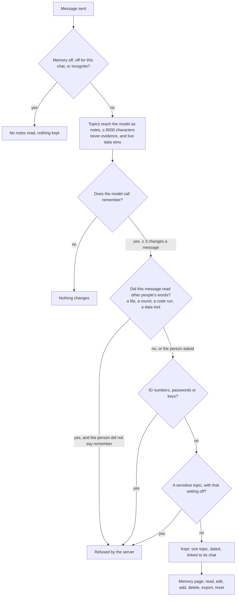

Nothing but the assistant reads memory: not the mapper, the engine, the policy or an export. The refusal is in
`memory.apply_call`, not the prompt, because a cell that says "remember prices include VAT" must never be believed next
week. Earlier chats are found by words through `search_chats` and `recent_chats`. An incognito chat is in no list and no
search and is deleted a day after its last message. A deleted chat leaves its topics, which are deleted on their own
(ADR-051).

## 8. State machines

### 8.1 Import round

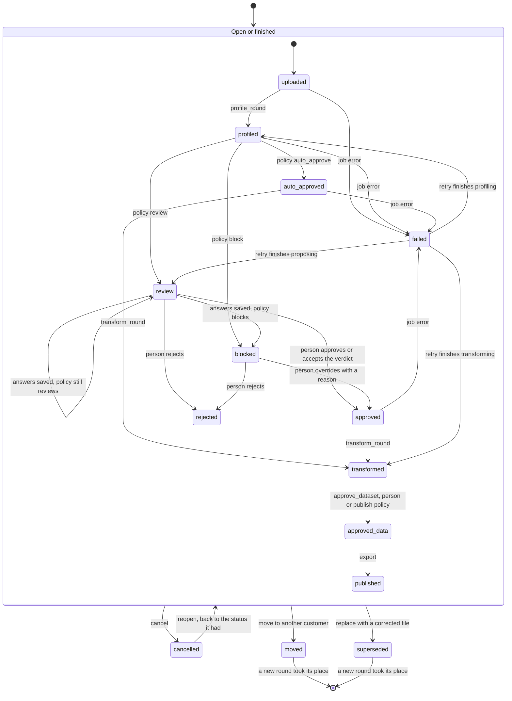

Any job that raises sets its round to `failed` and keeps the error on the summary (`jobs/runner.py`), so the
failure edges above are the common ones, not a complete list. A retry re-queues the same job: the round stays
`failed` until the job reaches its first unfinished stage and sets the next status. A saved Studio edit creates
a new proposed version and leaves the round's status unchanged; saved answers set it to `review` or `blocked`.
`cancelled`, `moved` and `superseded` are the closed statuses (§4.2). A reopen is refused once retention has removed
the round's files.

### 8.2 Mapping version

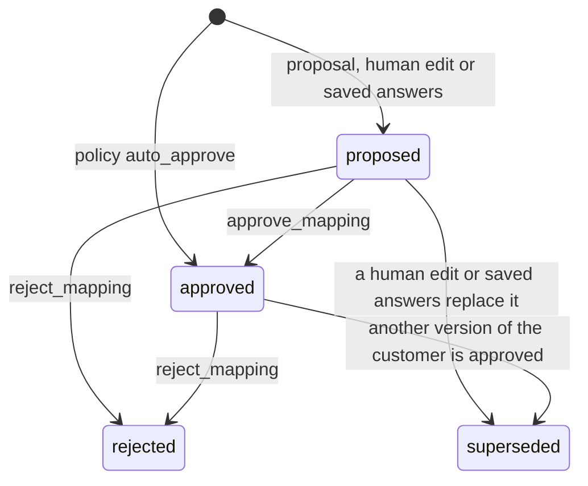

`approve_mapping` accepts only proposed or approved versions. `reject_mapping` has no status check. A superseded
version that was once approved stays in the approved-format library (ADR-046); other superseded and rejected
versions are never reused.

### 8.3 Dataset version

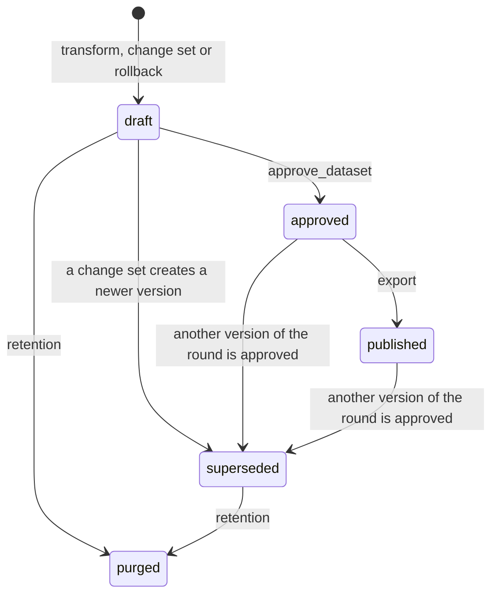

A rollback creates a new draft and leaves the version it came from unchanged. Retention removes the JSONL object
of old draft and superseded versions and marks the row `purged`; approved and published versions and the parents
of kept versions are kept (`policies/retention.yaml`).

### 8.4 Bulk-upload item

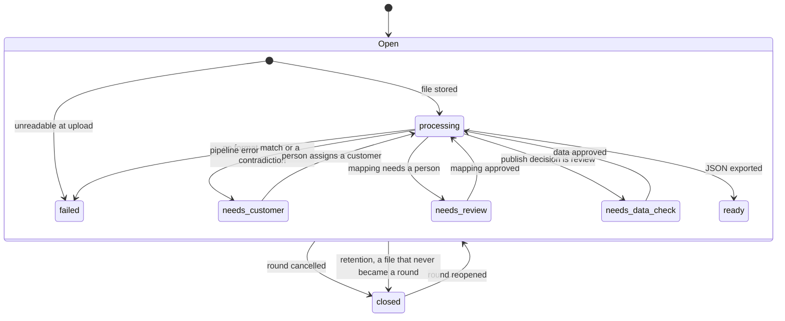

These are the states a file row shows (`batches.item_state`). They are derived from the stored item status
(`received`, `identified`, `needs_customer`, `attached`, `failed`, `purged`) and, once attached, from the round's
status. A moved or replaced round hands its row to the new round, so `closed` is only ever seen for a cancelled round
or a file retention removed. A closed file counts as done, and its JSON is not in the zip.

### 8.5 Job

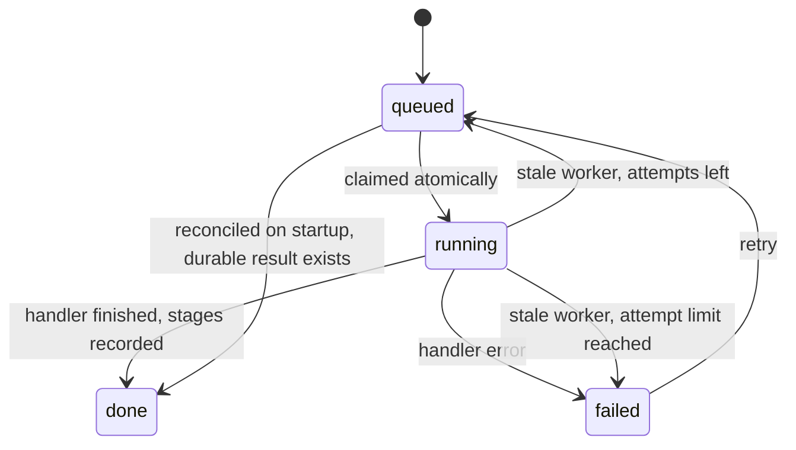

### 8.6 Review question

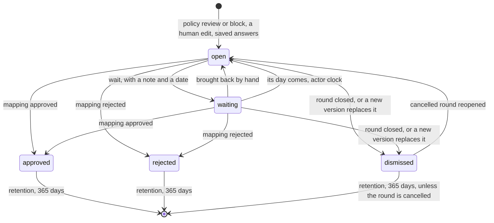

Waiting says whose turn it is and decides nothing about the file, and the policy never sees it. A waiting question
leaves the person's queue and every count. Reading the queue or the dashboard wakes what is due
(`review_queue.wake_due`), so there is no timer to fail. An open question older than 7 days is flagged on the home
page, and foresight lists it, along with customers whose answer is late. A question that was waiting when its round was
cancelled comes back as `open` if the round is reopened (ADR-053).

## 9. Error and recovery flows

| Situation | What happens | Where |
|---|---|---|
| Model fails, times out, or output rejected by the guard | heuristic draft used, `llm_fallback` → review, never auto-approve; breaker opens after N failures; backup routes tried | ADR-013, 015, 025 |
| Wrong file for a customer | drift `unrelated_file` → block; verdict names the likely owner when the layout matches another customer and the values differ | ADR-006, 036 |
| Zero rows | block | ADR-008 |
| Identity missing on some rows | review, with a high-priority reason (the `on_missing_identity` switch does not block) | ADR-008 |
| A report printed page by page | one table: the repeated headers and the title lines above them are dropped, and every row is kept | ADR-055 |
| A second price sheet, or a hidden one | the first source is used and a question says what was left out; a document mapping a collection twice is refused | ADR-055 |
| A currency or date order the file does not state plainly | a currency column is read and a date past the 12th settles the order; otherwise a question, never a quiet guess | ADR-055 |
| Prices with the VAT taken out, or in satang, in a file whose layout did not change | the reused mapping is still checked on last round's values: a steady factor on every SKU is a question, not a pass | ADR-056 |
| One SKU twice with different values | an engine error that holds the round; identical duplicates stay a warning | ADR-056 |
| A status or promotion kind FORMA has no word for | kept as written and refused by the contract's enum, so it reaches a person; never active or percent_off by default | ADR-056 |
| A column moved to another sheet | `columns_moved`: the approved mapping is not reused; the adaptation agent re-points it and a person reviews | ADR-057 |
| A model writes an option the engine does not know (`day_first`) | repaired when it is a known spelling, otherwise refused by the validator and sent back to the model — never ignored | ADR-057 |
| Records break the contract | approval and export refused; Data Editor shows them; a save is refused only for errors it adds | ADR-026 |
| Worker dies mid-job | stale recovery re-queues; stages already recorded are skipped; dataset objects are never partial | ADR-010, 015 |
| Queue was full or Redis down at upload time | bulk items detected as stuck; Resume re-enqueues; startup reconciliation marks jobs done when results exist | ADR-027, 044 |
| Storage outage | reads fail loudly; writes are object-first so a failed write leaves no row | ADR-012, 015 |
| Wrong data published | rollback creates a new version equal to the parent; re-export with a new sha256; audit lists every step | RUNBOOK |
| Provider key invalid or exhausted | Settings › AI test fails; backups take over in order; spend and breaker on Ops | ADR-025, 032 |
| Queue stopped while files wait | the navy card and the round page say so, and nothing is lost; Resume sends the files again | ADR-027, 044 |
| A file uploaded by mistake, or under the wrong customer | cancel the round, or move it with the same stored file; the verdict's wrong-file card opens the move with the customer chosen | ADR-052 |
| The customer corrects a delivery | replace the round; the zip and the counts show the new one | ADR-052 |
| A cancelled round is reopened after retention removed its files | refused, with what to do instead: upload again as a new round | ADR-052 |
| A question sits for too long | past 7 days it is flagged on the home page and in foresight; a customer's overdue answer is flagged the same way | ADR-053 |
| A round stops moving | after 60 days with no activity it is flagged on the home page and never closed by itself | ADR-053 |
| Sandbox not running | `run_python` is not offered, or the call says it could not be reached; the rest of the assistant keeps working | ADR-048 |
| A code run fails or times out | the model reads the error and tries again, inside the turn limit; nothing reaches a record | ADR-048 |
| A picture with no model that reads images | the assistant says it cannot read it, and no backup answers as if it had | ADR-049 |
| A preview of a work fails | the file stays downloadable, and the panel says so | ADR-050 |
| Retention off, or the backup is old | System health shows the last pass and the backup's age, amber past a day | ADR-053 |
| A backup fails or is cut off | it leaves nothing with a backup's name, older backups stay, and System health turns amber after a day | ADR-054 |
| The last backup holds no files | System health says database only, in amber | ADR-054 |
| Schema version rollout | register the new version; assign per customer or as default; diff view; the next round has no approved mapping under that version, so it is proposed like a first-time format, with no sandbox or field review | ADR-017, ADR-046, RUNBOOK |

## 10. Keeping the system tidy: retention and the nightly backup

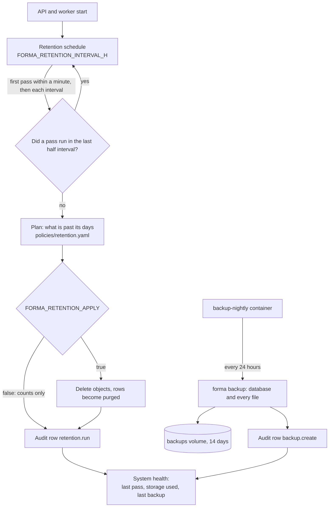

| What | Kept for | Stays regardless |
|---|---|---|
| Source files | 90 days after the round was published, rejected, blocked or closed | files of an open round, and bytes another round or a file waiting for a customer still uses |
| Work-round files that never became a round | 90 days after upload | the row, as `purged`, and bytes something else uses |
| Dataset versions | the last 5 per round | approved and published versions, and the parents of kept versions |
| Exports | 180 days | the dataset version, which can be exported again |
| Resolved questions | 365 days | those of a cancelled round, because a reopen brings them back; the audit log keeps every decision |
| Job rows | 30 days | |
| AI call rows | 365 days | |
| S3 local cache | 7 days | |

Retention never closes work: a round nobody has touched for 60 days is flagged on the home page and left to the person.
`FORMA_RETENTION_APPLY` defaults to false, so a pass only counts what it would delete until it is switched on. The
compose bucket is versioned, so a delete keeps the bytes on disk until a lifecycle rule expires them (R37). Chat files
stay out of retention and leave with their chat. The nightly backup holds the database and every object, and a restore
has been proven, but it stays on this machine ([RUNBOOK.md](RUNBOOK.md#who-can-reach-the-stack), R36, ADR-015, ADR-054).
