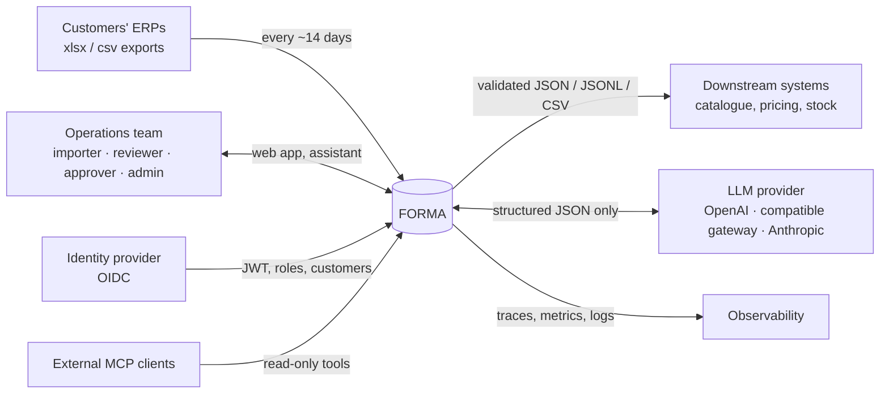
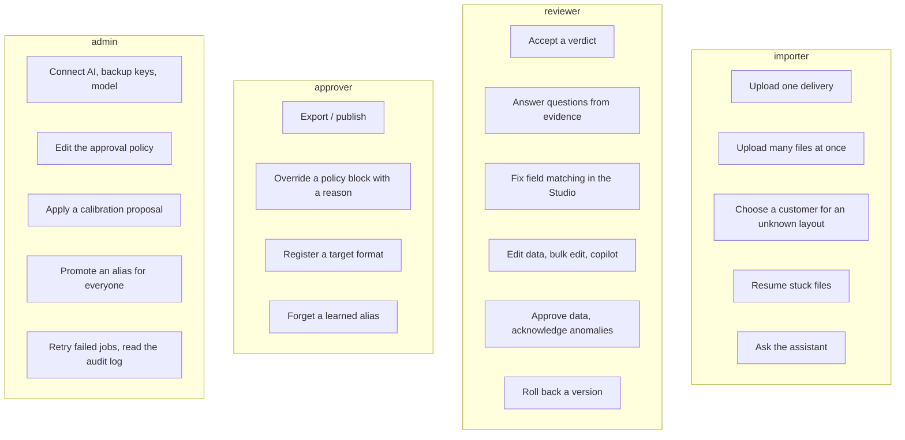
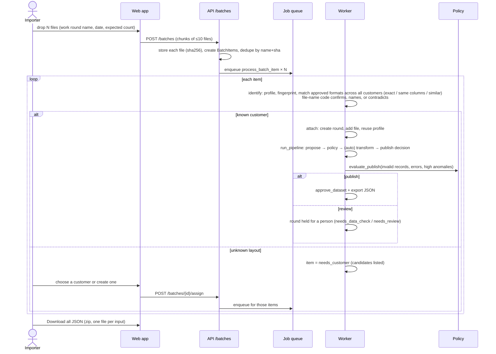
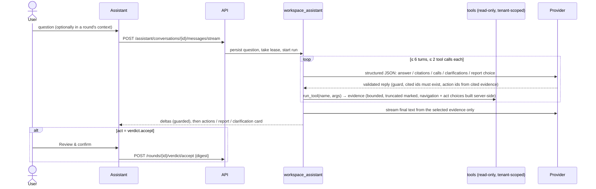
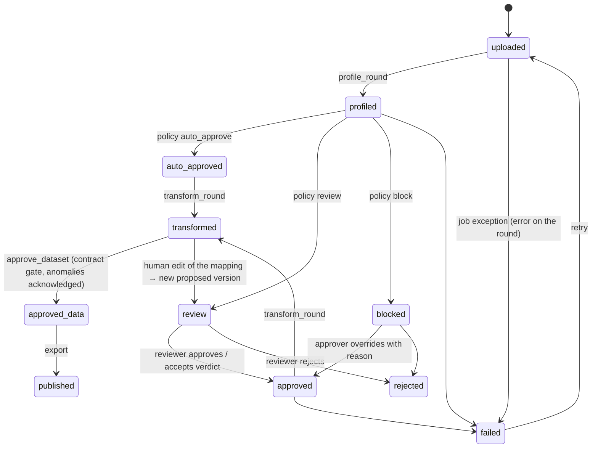
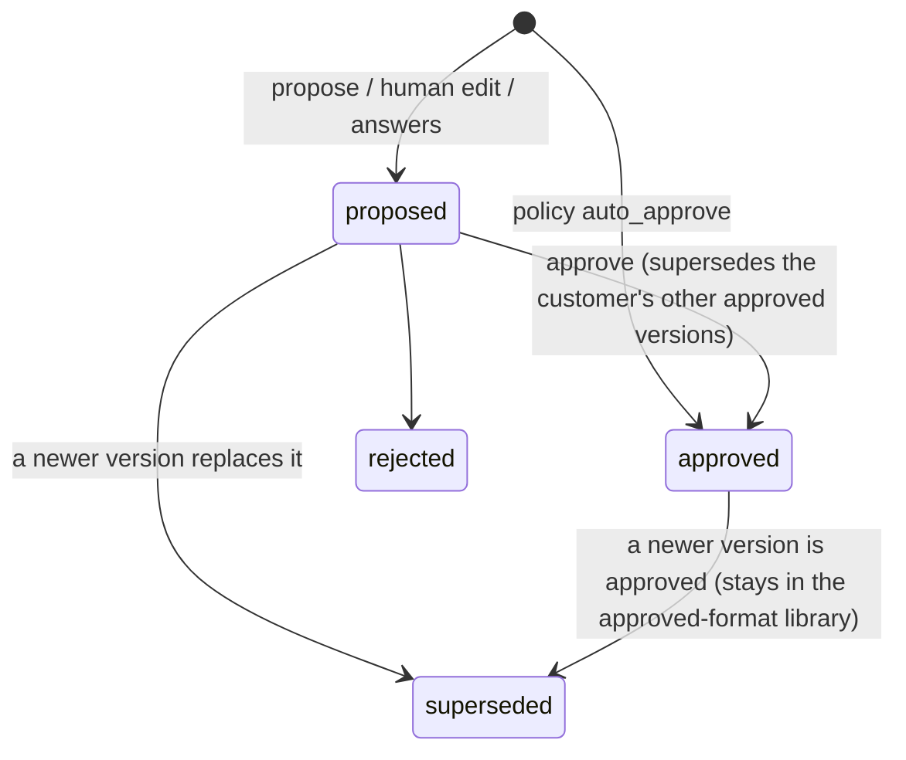
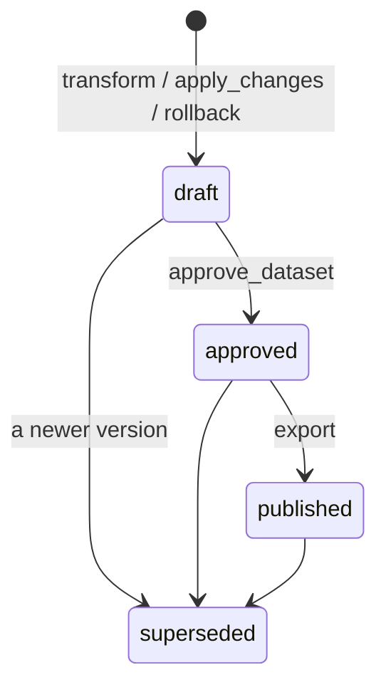
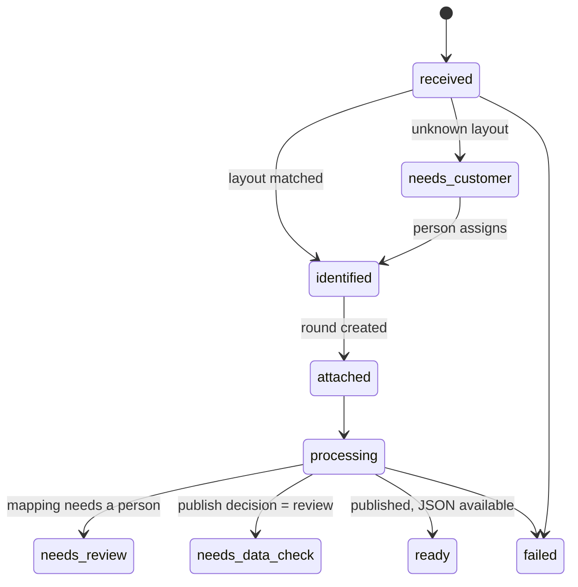
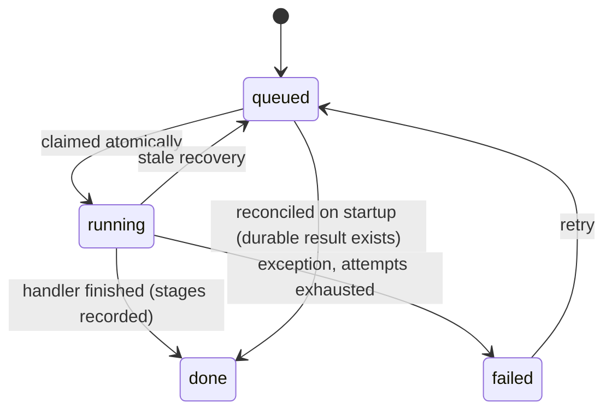

# FORMA — System flows (systems-analysis view)

> **สรุปภาษาไทย** — เอกสารนี้เขียนแบบ SA: context diagram, use case, ลำดับการทำงานทีละขั้น (process flow),
> sequence diagram ของแต่ละเส้นทาง และ state machine ของ round / mapping / dataset / batch item / job
> ทุกแผนภาพเป็น Mermaid (GitHub แสดงผลได้) แต่ละขั้นอ้าง ADR ที่เป็นเหตุผลของการออกแบบ

Diagrams are Mermaid; GitHub renders them. Each step names the module that implements it and the decision
record that explains why.

## 1. Context



## 2. Use cases



Roles nest: importer ⊂ reviewer ⊂ approver ⊂ admin. A tenant-scoped principal sees only its customers.

## 3. Master process flow: one delivery, upload to export


### Step-by-step with the technique and the reason

| # | Step | Module | Technique | Why this technique |
|---|---|---|---|---|
| 1 | Store the file | `ingestion/store.py` | content-addressed sha256, immutable object, storage key on the row | Re-uploads are detected, nothing is ever overwritten, every later version can point at exactly these bytes (ADR-005, ADR-012) |
| 2 | Sniff and read | `ingestion/sniff.py`, readers, `ooxml.py` | content sniffing, strict CSV decoding with BOMs, full-sheet OOXML streaming with bounded XML | Extensions lie, CSV encodings vary (TIS-620), and silent data loss (uncached formulas, error cells, zero padding) must surface as facts, not vanish (ADR-003, ADR-043) |
| 3 | Detect tables and profile columns | `profiling/` | blank-row block detection over the whole sheet, bounded header window, type inference, hints | ERP exports have titles, offsets and several tables per sheet; profiling must be descriptive so the mapper and the AI reason over facts, not raw cells |
| 4 | Fingerprint and classify drift | `fingerprint/` | strict + loose structural hashes, similarity, drift kinds; compare with the customer's approved format and with other customers' formats | Memory needs an exact key; drift needs a vocabulary a policy can reason about; a file identical to another customer's format is the strongest wrong-file signal (ADR-006) |
| 5 | Pick the mapping source | `services/mapping.py`, `format_memory.py` | memory (identical) → approved library (exact layout anywhere in history, newest first; closest compatible as adaptation baseline) → heuristic → AI | Reuse what a person approved before anything is guessed; a customer that alternates between two ERP layouts should not be re-asked (ADR-046) |
| 6 | Heuristic draft | `ai/heuristics.py` | synonym scoring (exact, containment, fuzzy), hint boosts, type compatibility, uniqueness for keys, value overlap, VAT guess from headers; learned aliases win outright; learned constants replace guesses | Deterministic, free, explainable, 0.996 on the corpus; it is the floor and the fallback, so the system never depends on a model being up (ADR-002, ADR-038) |
| 7 | AI refinement | `ai/agents.py`, `ai/llm.py`, `ai/guard.py` | structured JSON output against a schema, validation callback (DSL + static validation), retries, backup routes, output guard | The model adds judgement (nested promotions, ambiguous columns) but can only move inside the DSL; invalid or injected output is rejected and the draft is used; the full target schema is in the prompt so the model maps to the real contract (ADR-013, ADR-025, ADR-043) |
| 8 | Validate and simulate | `mapping_dsl/validate.py`, `simulate` | static validation; engine run on a bounded sample | Catch bad pointers and arity before data; give the policy rows, errors and warnings to reason about |
| 9 | Sandbox | `services/sandbox.py` | run the new and the approved mapping on the same real files; compare by schema identity | A new mapping must prove it does not lose records or break prices before it replaces the approved one; thresholds belong to the policy (ADR-018) |
| 10 | Field review | `services/healing.py` | per changed field: equal share, steady ratio (×1.07 = VAT), scaled, different, on the same SKUs as last round's published data | A header that looks similar may mean something else; the data says whether it does (ADR-021) |
| 11 | Field memory | `mapping.py::_inherit_confidence` | unchanged fields take confidence 1.0 from the approved mapping | A person already approved exactly this mapping of this field; asking again is noise (ADR-037) |
| 12 | Policy | `ai/policy.py` | thresholds per risk, allowed drift, warnings budget, first-time rule, row sanity, hard blocks, sandbox limits, meaning doubts, trust-data-checks, per-customer overrides | Automation is a configuration decision owned by the team, with reasons, never a model's opinion (ADR-008, ADR-037) |
| 13 | Verdict | `services/verdict.py` | ordered hypothesis rules over the stored reports; suppression of same-rule-different-data, repeated patterns, no-data checks; confidence word; digest | A reviewer reads one sentence and decides one to three things; the evidence is one click away, not in the way (ADR-036) |
| 14 | Review | `review_questions.py`, `review_evidence.py`, `ReviewWorkspace` | questions from fields under the confidence bar; answers become a new version with evidence; evidence traced to cells through engine provenance; preview on the same sample | Decisions are bounded and auditable; the person sees the actual cell, never a guess (ADR-029, ADR-035) |
| 15 | Learning | `services/learning.py` | diff approved vs proposed (nearest system/ai ancestor) → aliases, constants, accepted; uses counted; suggestions ≥ 3 customers; admin promotes | A correction is made once per customer and once for everyone; the evidence on every learned field says where it came from (ADR-038) |
| 16 | Transform | `engine/transform.py`, `services/datasets.py` | Polars lazy compilation, vectorised records, persistent overrides re-applied, schema validation with invalid count, object-first write | Deterministic, fast, and nothing partial is visible (ADR-002, ADR-015, ADR-024, ADR-026) |
| 17 | Change intelligence | `datasets.py::change_report`, `anomalies.py` | diff vs the last published dataset; robust outliers (median/MAD); per-kind anomalies with severity; "% normal" | Reviewers need what changed and what looks wrong, not the whole table; high anomalies need an acknowledgement (ADR-022) |
| 18 | Edit | `datasets.py::apply_changes`, `assistant.py` | staged operations, impact preview, schema check that refuses only added errors, change set → new version; copilot plans, never applies | Fixes are reviewable and reversible; invalid records can be fixed one at a time (ADR-023, ADR-024, ADR-026) |
| 19 | Approve and export | `datasets.py::approve_dataset/export_dataset`, `publishing.py` | contract gate (no invalid records), anomaly acknowledgement, approver role for export, atomic artifact with sha256, exact `export_view` fields | The downstream never receives a record that breaks the contract or a field it did not ask for (ADR-017, ADR-026) |
| 20 | Calibration | `services/calibration.py` | outcomes per decision from corrections, version chain, change sets, rollbacks; precision per rule; proposals with evidence; admin applies | Thresholds are justified by what happened, and the next report shows whether a change was right (ADR-037) |

## 4. Bulk upload and automatic publishing



Stuck items (queue full or down at upload time) are detected and resumed (`POST /batches/{id}/resume`); on
startup, queued jobs whose results already exist are reconciled instead of re-run (ADR-027, ADR-044).

## 5. Review and verdict

```mermaid
sequenceDiagram
  actor R as Reviewer
  participant UI as Review page
  participant API as API
  participant V as verdict_flow
  participant M as mapping service
  R->>UI: open a file from the queue
  UI->>API: GET /mappings/{id}/questions · GET /rounds/{id}/verdict
  API->>V: current(round) — stored, or recomputed when rules/status moved
  V-->>UI: conclusion, outcome, confidence, must_decide, evidence, suppressed, digest
  alt outcome = accept
    R->>UI: Accept and continue
    UI->>API: POST /rounds/{id}/verdict/accept {digest}
    API->>M: approve_mapping (block refused; audit verdict.accept with rules_fired)
  else outcome = answer
    R->>UI: answer the 1–3 decisions (yes/no, number, confirm as read)
    UI->>API: POST /rounds/{id}/verdict/accept {digest, decisions}
    API->>M: answer_document → apply_answers → new proposed version → policy again
  else fix_mapping / assign_customer / reject_file
    UI-->>R: link to the Studio, the customer choice, or reject
  end
```

A stale digest (the file changed since the verdict was shown) is refused with 409 (ADR-036).

## 6. Learning and calibration loop


## 7. Assistant with grounded evidence and confirmable actions



The model never supplies URLs, chart values, code or payloads; it selects server-built ids. Reports are
computed by the server under the user's permissions and persisted as snapshots (ADR-029, ADR-040, ADR-042,
ADR-045).

## 8. State machines

### 8.1 Import round



### 8.2 Mapping version



### 8.3 Dataset version



### 8.4 Bulk-upload item



### 8.5 Job



## 9. Error and recovery flows

| Situation | What happens | Where |
|---|---|---|
| Model fails, times out, or output rejected by the guard | heuristic draft used, `llm_fallback` → review, never auto-approve; breaker opens after N failures; backup routes tried | ADR-013, 015, 025 |
| Wrong file for a customer | drift `unrelated_file` → block; verdict names the likely owner when the layout matches another customer and the values differ | ADR-006, 036 |
| Zero rows, missing identity | block | ADR-008 |
| Records break the contract | approval and export refused; Data Editor shows them; a save is refused only for errors it adds | ADR-026 |
| Worker dies mid-job | stale recovery re-queues; stages already recorded are skipped; dataset objects are never partial | ADR-010, 015 |
| Queue was full or Redis down at upload time | bulk items detected as stuck; Resume re-enqueues; startup reconciliation marks jobs done when results exist | ADR-027, 044 |
| Storage outage | reads fail loudly; writes are object-first so a failed write leaves no row | ADR-012, 015 |
| Wrong data published | rollback creates a new version equal to the parent; re-export with a new sha256; audit lists every step | RUNBOOK |
| Provider key invalid or exhausted | Settings › AI test fails; backups take over in order; spend and breaker on Ops | ADR-025, 032 |
| Schema version rollout | register the new version; assign per customer or as default; diff view; sandbox and policy re-run on the next round | ADR-017, RUNBOOK |
