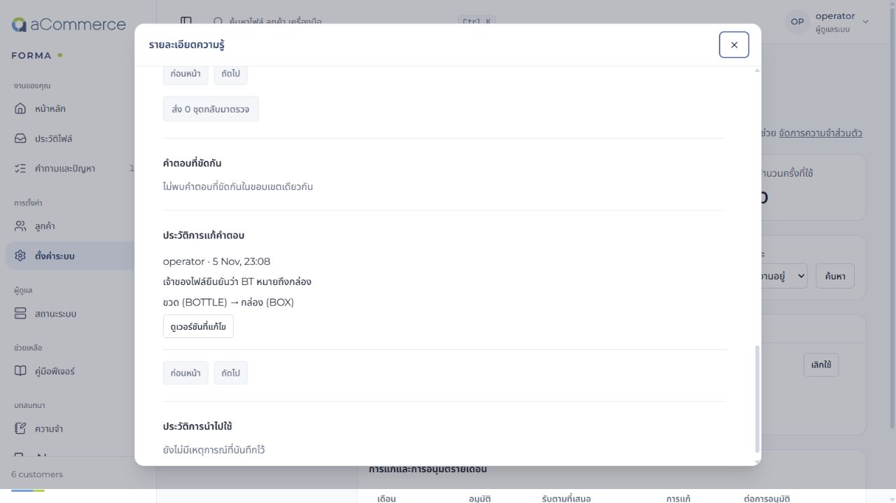

# การแก้ความรู้และคำถามในการจับคู่ข้อมูล — 5 พฤศจิกายน 2026

## สิ่งที่เปลี่ยนทั้ง 6 ข้อ

| เรื่อง | ก่อน | หลัง |
| --- | --- | --- |
| แก้คำตอบที่จำผิด | เลิกใช้ได้ แต่ต้องเข้าไปแก้กฎในหน้าจับคู่ | แก้คำตอบจากรายละเอียดความรู้ ระบุเหตุผล ดูผลก่อน–หลัง แล้วสร้างเวอร์ชันรออนุมัติ |
| ผลกระทบข้ามรอบ | ประวัติการใช้ไม่ครอบคลุมการนำไปใช้ต่อทางอ้อม | ไล่ความสัมพันธ์ของเวอร์ชัน แสดงชุดไฟล์ที่ได้รับผลกระทบ และเลือกส่งกลับมาตรวจเฉพาะชุดที่ต้องการ |
| คำถาม | ผู้ใช้ต้องเชื่อมข้อความเทคนิคกับไฟล์เอง | เพิ่มคำถามภาษาง่าย เหตุผลที่ต้องถาม และชื่อไฟล์/ชีต/คอลัมน์พร้อมค่าตัวอย่างจริง เก็บข้อความธุรกิจเดิมไว้ด้วย |
| คำตอบ | บางค่าหรือขอบเขตยังไม่ชัดเจน | หน่วยแสดงชื่อพร้อมรหัส เช่น ขวด (BOTTLE); ข้อความ VAT ใช้เฉพาะฟิลด์ VAT; แจ้งขอบเขตและจำนวนรายการที่เปลี่ยน มีตัวเลือกยังไม่ทราบ |
| รูปแบบที่เคยรู้จัก | โครงสร้างเหมือนกันยังอาจใช้เงื่อนไขการอ่านค่าเดิม | ตรวจบริบทที่สังเกตได้ เช่น ประเทศ สกุลเงิน ภาษา รูปแบบวันที่/ตัวเลข และค่าหน่วยคงที่ ก่อนใช้กฎเดิมซ้ำ |
| การทดสอบ | ยังไม่มีเส้นทางแก้คำตอบโดยตรงครบวงจร | เพิ่ม regression สำหรับแก้คำตอบ ใช้ซ้ำข้ามรอบ รหัสใหม่ ถอนความรู้ ผลกระทบทางอ้อม สิทธิ์ และคำขอพร้อมกัน |

## วิธีใช้งาน

ไปที่ **ตั้งค่าระบบ → What FORMA learned** (ความรู้การจับคู่, `/settings?tab=learning`) แล้วเปิดคำตอบที่ต้องการแก้:

1. กด **แก้คำตอบ** เลือกหรือกรอกคำตอบใหม่ และระบุเหตุผล
2. กด **ดูผลก่อนบันทึก** ระบบประมวลผลทั้งชุดไฟล์ เปรียบเทียบจำนวนรายการ ฟิลด์ที่เปลี่ยน และข้อผิดพลาด แสดงตัวอย่างไม่เกิน 5 รายการ
3. กด **บันทึกคำตอบใหม่เพื่อรออนุมัติ** คำตอบเก่าจะเลิกใช้ทันที ส่วนคำตอบใหม่ยังไม่นำไปเรียนรู้จนผ่านการตรวจและอนุมัติตามปกติ
4. ดู **ไฟล์ที่เคยใช้คำตอบนี้** แล้วเลือกชุดไฟล์ที่จะส่งกลับมาตรวจ ระบบสร้างเวอร์ชันใหม่สำหรับตอบคำถามและอนุมัติ
5. ดู **ประวัติการแก้คำตอบ** เพื่อตรวจผู้แก้ เวลา เหตุผล คำตอบก่อน–หลัง และเปิดเวอร์ชันที่เกี่ยวข้อง

หน้าประวัติเก็บ mapping และผลลัพธ์เก่าไว้ ไม่เขียนทับ JSON หรือไฟล์ที่เคยดาวน์โหลด การแก้คำตอบจึงไม่ได้แก้ผลลัพธ์ที่เคยเผยแพร่ย้อนหลังโดยอัตโนมัติ

## ผลตรวจ

- Backend: **104 เคสไม่ซ้ำผ่านทั้งหมด** จากชุดที่เกี่ยวข้องกับความรู้ คำถาม การตรวจผล และการแก้คำตอบ ไม่ใช่การรัน backend ทั้ง repository ใหม่
- Frontend: **15 เคสผ่าน**; TypeScript และ production build ผ่าน
- Ruff lint/format และ mypy ผ่าน
- Frontend lint: 0 errors; มี 19 warnings เดิม และ build ยังมีคำเตือนขนาด bundle เกิน 500 kB
- ไม่มีการเรียก API โมเดลเสียเงิน ค่าใช้จ่าย API **$0**

หลักฐาน XML: `memory.xml`, `review.xml`, `corrections.xml`, `final-changes.xml` ชุดสุดท้ายทดสอบซ้ำบางเคสหลังปรับรายละเอียด จึงนับยอดรวมด้วยชื่อเคสไม่ซ้ำ ดู `verification.json`

### ตรวจบน PostgreSQL ใน repro แยกจาก dev

ใช้โมเดลจำลองกับ CSV 6 รายการ และกฎหน่วยขาย `BT → BOTTLE`:

- แก้เป็น `BT → BOX` แล้ว preview พบการเปลี่ยน **2 จาก 6 รายการ** จำนวนรายการก่อน–หลังเท่าเดิม
- ส่งบันทึกพร้อมกันสองคำขอ: ได้ **201 และ 409** จึงไม่เกิดเวอร์ชันแก้ซ้ำจากข้อมูลตั้งต้นเดียวกัน
- mapping เดิมไม่เปลี่ยน และคำตอบใหม่ผ่านขั้นอนุมัติได้
- ในโหมด production ที่บังคับนโยบายความรู้ ระบบยังปฏิเสธการนำข้อมูลทดสอบที่ไม่ได้รับอนุญาตไปใช้ซ้ำ ไม่ได้ผ่อนนโยบายเพื่อให้ทดสอบผ่าน
- เส้นทางเรียนรู้ข้ามรอบและเลือกส่งงานที่ใช้ความรู้ต่อทางอ้อมกลับมาตรวจ ผ่านชุด regression ในฐานทดสอบแยกที่ใช้ legacy policy

รายละเอียดผลจริงอยู่ใน `repro-proof.json` ตรวจ UI ในเบราว์เซอร์บน repro สำหรับแบบฟอร์มแก้คำตอบ ตารางก่อน–หลัง และประวัติการแก้ไขแล้ว

## ขอบเขตและสิ่งที่ยังต้องยืนยัน

- ค่าประเทศ สกุลเงิน และหน่วยมาจากคอลัมน์ที่ระบุชัด ไม่เดาจากชื่อไฟล์ ภาษา หรือสัญลักษณ์เงิน การสังเกตบริบทใช้ตัวอย่างจาก profiler จึงยังไม่ใช่ข้อพิสูจน์ของทุกแถวหรือทุกความหมายทางธุรกิจ
- การตรวจความเข้ากันได้ที่เพิ่มขึ้นช่วยป้องกันการใช้กฎเดิมผิดบริบท แต่ไม่ได้รับรองว่า unknown format ทุกแบบจะจับคู่ถูก ต้องใช้การตรวจผลและ human review ต่อไป
- ผลครั้งนี้ยืนยันกลไกและ flow ด้วยโมเดลจำลอง ไม่ได้ให้คะแนนความแม่นยำของ DeepSeek หรือเทียบกับ ChatGPT/Claude
- ถ้าไฟล์ต้นทางถูกปิดใช้/ลบตามอายุข้อมูล หรือกฎล่าสุดไม่ตรงกับคำตอบเดิม ระบบให้เปิดตรวจหรืออัปโหลดใหม่ แทนการแก้กฎโดยเดา
- การแสดงผลกระทบแบ่งหน้าละ 50 ชุด แต่การไล่ความสัมพันธ์ยังอ่านเวอร์ชันของลูกค้ารายนั้น จึงควรวัดเพิ่มเมื่อมีประวัติขนาดใหญ่

## การนำขึ้นใช้งาน

ไม่ต้องเพิ่ม migration ฐานข้อมูล ให้ rebuild API, worker และ web พร้อมกันก่อนใช้งานบน stack หลัก งานนี้ทดสอบบน repro แยก ไม่ได้ restart stack dev หรือเปลี่ยนจำนวน worker/RAM/API key
